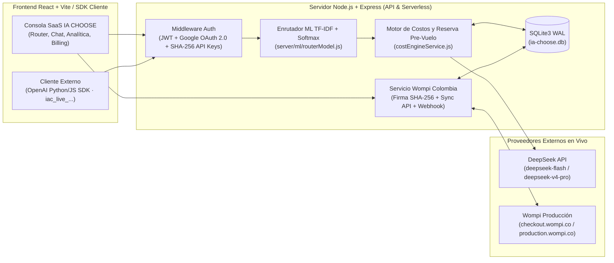

# IA CHOOSE  Consola de Enrutamiento Inteligente de LLMs y Billetera Prepago en COP

**IA CHOOSE** es una plataforma SaaS y Gateway de Inteligencia Artificial diseñada para el contexto colombiano y latinoamericano. Combina un **Enrutador de Machine Learning basado en Benchmarks oficiales** (`SWE-bench`, `MATH-500`, `LongBench`, `Arena-Hard`, `MMLU-Pro`) con una **billetera prepago en pesos colombianos (COP)** integrada con **Wompi Colombia** y un **Motor de Liquidación Financiera por Token** en tiempo real.

---

## Tabla de Contenidos

1. [Descripción General y Problema que Resuelve](#1-descripción-general-y-problema-que-resuelve)
2. [Arquitectura Técnica del Sistema](#2-arquitectura-técnica-del-sistema)
3. [Modelos de IA Integrados y Tarifario en COP](#3-modelos-de-ia-integrados-y-tarifario-en-cop)
4. [Buenas Prácticas de Machine Learning (Enrutador IA)](#4-buenas-prácticas-de-machine-learning-enrutador-ia)
5. [Motor Financiero, Liquidación por Token y Pasarela Wompi](#5-motor-financiero-liquidación-por-token-y-pasarela-wompi)
6. [APIs y Endpoints Disponibles (Gateway Compatible con OpenAI)](#6-apis-y-endpoints-disponibles-gateway-compatible-con-openai)
7. [Tecnologías y Dependencias](#7-tecnologías-y-dependencias)
8. [Instalación y Ejecución Local](#8-instalación-y-ejecución-local)
9. [Estructura del Código Fuente](#9-estructura-del-código-fuente)
10. [Vistas y Demostración del Sistema (Screenshots)](#10-vistas-y-demostración-del-sistema-screenshots)
11. [Equipo Desarrollador](#11-equipo-desarrollador)

---

## 1. Descripción General y Problema que Resuelve

En Latinoamérica, el acceso a modelos de lenguaje de frontera suele exigir tarjetas de crédito internacionales y suscripciones fijas en dólares (`$20 USD/mes`), además de desperdiciar recursos al invocar modelos pesados de razonamiento para consultas básicas.

**IA CHOOSE** soluciona ambos problemas mediante:
- **Enrutamiento Inteligente Multi-Tarea (ML)**: Analiza cada prompt del usuario, predice su **dominio técnico** y su **complejidad continua (`[0, 1]`)**, y selecciona el modelo más costo-eficiente que supere el umbral del benchmark requerido (generando ahorros del **73 % al 90 %** en costos de inferencia).
- **Micropagos Prepago en Pesos Colombianos (COP)**: Integración con el **Web Checkout y API de Wompi Colombia** (Nequi, Bancolombia, PSE) con validación criptográfica `SHA-256` y sincronización automática de transacciones aprobadas.
- **API Gateway para Clientes (`iac_live_...`)**: Permite a desarrolladores y empresas consumir los modelos mediante el estándar de OpenAI (`/api/v1/chat/completions`), descontando cada token procesado del saldo en COP sin exponer las llaves maestras del proveedor.

---

## 2. Arquitectura Técnica del Sistema



---

## 3. Modelos de IA Integrados y Tarifario en COP

El sistema opera con conexión real en vivo hacia la API oficial de **DeepSeek**, diferenciando automáticamente entre inferencia rápida sin sobrecosto de pensamiento (*Flash*) y razonamiento profundo (*Pro*):

| Modelo en IA CHOOSE | ID Remoto API | Categoría (`Tier`) | `SWE-bench` (Código) | `MATH-500` (Lógica) | `LongBench` (Contexto) | `Arena-Hard` (Redacción) | `MMLU-Pro` (General) | Ventana de Contexto | Tarifa Base (COP) |
| :--- | :--- | :---: | :---: | :---: | :---: | :---: | :---: | :---: | :---: |
| **DeepSeek V4.1 Flash** | `deepseek-flash` | `balanced` | 89.4 % | 93.8 % | 92.5 % | 90.8 % | 91.2 % | 1.048.576 tok | **$10 COP** |
| **DeepSeek V4 Pro** | `deepseek-v4-pro` | `frontier` | 94.6 % | 97.1 % | 94.8 % | 93.5 % | 94.9 % | 1.048.576 tok | **$14 COP** |

---

## 4. Buenas Prácticas de Machine Learning (Enrutador IA)

El clasificador y regresor propio de **IA CHOOSE** ([`server/ml/routerModel.js`](server/ml/routerModel.js)) fue diseñado bajo prácticas rigurosas de ingeniería de Machine Learning:

### 4.1. Manejo del Dataset y Extracción de Características (NLP)
- **Corpus Etiquetado ([`server/ml/trainingDataset.js`](server/ml/trainingDataset.js))**: `145 muestras` balanceadas en **5 dominios** (`coding`, `math_reasoning`, `long_context`, `creative_writing`, `general_qa`), incluyendo **pares trampa (*trap cases*)** que comparten la misma palabra clave (ej. *"Python"*, *"Ecuación"*, *"Tesis"*) pero difieren radicalmente en complejidad técnica.
- **Preprocesamiento Morfológico en Español**: Normalización Unicode NFD, eliminación de diacríticos, *stemming* de sufijos en español (`-ciones`, `-miento`, `-mente`, `-ando`, `-iendo`) y extracción de **2.557 features** combinando unigramas, bigramas y raíces morfológicas con ponderación **TF-IDF sublineal** y normalización $\ell_2$.
- **Arquitectura Multi-Cabeza**:
  1. **Cabeza de Clasificación de Dominio**: Regresión Logística Multinomial (*Softmax*) entrenada con descenso de gradiente y regularización $\ell_2$ ($\lambda = 0.0008$).
  2. **Cabeza de Regresión de Complejidad**: Regresor sigmoideo continuo $\hat{y} \in [0, 1]$ combinado con señales estructurales del prompt (densidad técnica y longitud semántica).

### 4.2. Partición Estratificada (`Train / Validation / Test Split`)
- **Entrenamiento (`Train Split` — 80 %)**: `115 muestras` utilizadas para optimizar los pesos $W, b, w_c, b_c$ y el vector $\text{IDF}$ (previniendo *data leakage* hacia validación).
- **Validación Out-of-Sample (`Validation Split` — 20 %)**: `30 muestras` estratificadas por dominio y nivel de complejidad, nunca vistas durante el ajuste de pesos.
- **Conjunto de Pruebas Adversarias (`Trap Test Suite`)**: `8 casos de prueba` pareados (básico vs. frontera con idéntica palabra clave) evaluados al finalizar el entrenamiento.

### 4.3. Métricas de Evaluación Obtenidas (`npm run train`)

Ejecutando `npm run train` ([`scripts/trainRouter.js`](scripts/trainRouter.js)):

| Dominio | Soporte (Val) | Precisión (`Precision`) | Exhaustividad (`Recall`) | `F1-Score` |
| :--- | :---: | :---: | :---: | :---: |
| **`coding`** (Ingeniería de Software) | 8 | 100.0 % | 87.5 % | **93.3 %** |
| **`math_reasoning`** (Matemáticas y Lógica) | 6 | 100.0 % | 100.0 % | **100.0 %** |
| **`long_context`** (Tesis y Documentos) | 6 | 100.0 % | 100.0 % | **100.0 %** |
| **`creative_writing`** (Redacción Editorial) | 5 | 100.0 % | 100.0 % | **100.0 %** |
| **`general_qa`** (Consulta General) | 5 | 83.3 % | 100.0 % | **90.9 %** |
| **Resumen Global (Validación)** | **30** | **Val Acc: `96.7 %`** | **Macro-F1: `96.8 %`** | **Val MAE: `0.1000`** |

#### Matriz de Confusión (Validación Out-of-Sample)
```text
Real \ Predicho    |  coding |  math_r |  long_c |  creatv |  gen_qa
--------------------------------------------------------------------
coding             |       7 |       0 |       0 |       0 |       1
math_reasoning     |       0 |       6 |       0 |       0 |       0
long_context       |       0 |       0 |       6 |       0 |       0
creative_writing   |       0 |       0 |       0 |       5 |       0
general_qa         |       0 |       0 |       0 |       0 |       5
```

---

## 5. Motor Financiero, Liquidación por Token y Pasarela Wompi

El módulo [`server/services/costEngineService.js`](server/services/costEngineService.js) implementa una arquitectura de **Reserva Pre-Vuelo en 2 Fases (Two-Phase Wallet Commit)**:
1. **Fase 1 — Reserva Atómica (`reserveBalance`)**: Antes de llamar a la API externa, bloquea atómicamente en SQLite (`BEGIN IMMEDIATE`) el costo estimado según los tokens de entrada y el techo de salida. Si la API externa falla, libera la reserva (`releaseReservation`) cobrando **`$0 COP`**.
2. **Fase 2 — Liquidación Real (`calculateSettlement`)**: Con los tokens reales reportados por el proveedor (`prompt_tokens`, `cached_tokens`, `completion_tokens`, `reasoning_tokens`), calcula el costo exacto en USD y COP, descuenta del saldo disponible y registra la auditoría en `request_cost_audit`.
3. **Pasarela Wompi Colombia ([`server/services/wompiService.js`](server/services/wompiService.js))**:
   - Genera sesiones firmadas con `SHA256(reference + amountInCents + "COP" + WOMPI_INTEGRITY_SECRET)`.
   - Redirige al **Web Checkout Oficial de Wompi** (`https://checkout.wompi.co/p/`) con soporte nativo para **Nequi**, **Botón Bancolombia** y **PSE**.
   - Sincroniza automáticamente al iniciar sesión (`syncUserTransactionsFromWompi`) cualquier pago `APPROVED` desde `https://production.wompi.co/v1/transactions`.

---

## 6. APIs y Endpoints Disponibles (Gateway Compatible con OpenAI)

| Método | Ruta | Autenticación | Descripción |
| :---: | :--- | :--- | :--- |
| `POST` | `/api/register` | Pública | Registro de nuevo usuario y creación de billetera COP. |
| `POST` | `/api/login` | Pública | Inicio de sesión con correo/contraseña (retorna JWT). |
| `POST` | `/api/google` | Pública | Inicio de sesión con Google OAuth 2.0 (`google-auth-library`). |
| `GET` | `/api/dashboard/summary` | Bearer JWT | Resumen de KPIs, billetera, logs, auditorías y sincronización Wompi. |
| `POST` | `/api/dashboard/recommend-task` | Bearer JWT | Clasifica el prompt con el modelo ML y recomienda el LLM óptimo. |
| `POST` | `/api/dashboard/execute-task` | Bearer JWT | Ejecuta la consulta en vivo en el LLM y liquida el costo en COP. |
| `POST` | `/api/payments/wompi/checkout` | Bearer JWT | Crea orden de recarga firmada con SHA-256 para Wompi Checkout. |
| `POST` | `/api/payments/wompi/verify` | Bearer JWT | Verifica una transacción en la API de Wompi y acredita el saldo. |
| `POST` | `/api/payments/wompi/webhook` | Firma Evento Wompi | Webhook asíncrono para eventos `transaction.updated` de Wompi. |
| `GET` | `/api/v1/models` | `Bearer iac_live_...` | Lista los modelos activos (estándar OpenAI `/v1/models`). |
| `POST` | `/api/v1/chat/completions` | `Bearer iac_live_...` | Gateway de inferencia compatible con SDK de OpenAI / DeepSeek. |

### Ejemplo de Consumo desde Python (SDK OpenAI)
```python
from openai import OpenAI

client = OpenAI(
    api_key="iac_live_tu_clave_generada_en_ia_choose",
    base_url="http://localhost:3001/api/v1"
)

response = client.chat.completions.create(
    model="deepseek-v4-flash",  # o "auto" para enrutamiento ML automático
    messages=[{"role": "user", "content": "Explica el patrón Saga en microservicios"}]
)
print(response.choices[0].message.content)
```

---

## 7. Tecnologías y Dependencias

- **Frontend**: React `18.3.1`, Vite `6.0.5`, CSS3 Responsive con diseño personalizado y asistente interactivo `PixelRobot`.
- **Backend**: Node.js (`>= 22.x`), Express `4.21.2`, SQLite nativo (`node:sqlite` en modo `WAL`).
- **Seguridad y Autenticación**: `jsonwebtoken` `9.0.2`, `bcryptjs` `2.4.3`, `google-auth-library` `11.3.4`, firmas `HMAC/SHA-256` (`node:crypto`).
- **Machine Learning**: Motor propio en JavaScript (`server/ml/routerModel.js`) sin dependencias pesadas externas, con TF-IDF, Softmax y regresión de complejidad.
- **Archivos de Entorno Reproducibles**: [`package.json`](package.json), [`requirements.txt`](requirements.txt) y [`environment.yml`](environment.yml).

---

## 8. Instalación y Ejecución Local

### 8.1. Prerrequisitos
- **Node.js** `v22.5.0` o superior (incluye soporte nativo para `node:sqlite`).
- **Git** instalado.

### 8.2. Pasos de Instalación
```bash
# 1. Clonar el repositorio
git clone https://github.com/Jersson99/IA-Choose.git
cd IA-Choose

# 2. Instalar dependencias de Node.js
npm install

# 3. Configurar variables de entorno (.env en la raíz)
cp .env.example .env
```

Variables requeridas en `.env`:
```env
GOOGLE_CLIENT_ID=tu_google_client_id.apps.googleusercontent.com

WOMPI_ENV=production
WOMPI_PUBLIC_KEY=pub_prod_...
WOMPI_PRIVATE_KEY=prv_prod_...
WOMPI_INTEGRITY_SECRET=prod_integrity_...
WOMPI_EVENTS_SECRET=prod_events_...

DEEPSEEK_API_KEY=sk-...
DEEPSEEK_BASE_URL=https://api.deepseek.com/v1
DEEPSEEK_MODEL_ID=deepseek-flash
```

### 8.3. Comandos de Ejecución
```bash
# Entrenar el modelo de Machine Learning y ver el reporte de métricas (Train/Val/Test)
npm run train

# Iniciar simultáneamente el servidor Backend (puerto 3001) y el Frontend Vite (puerto 5173)
npm run dev

# Compilar versión optimizada para producción
npm run build
```

---

## 9. Estructura del Código Fuente

```text
IA-Choose/
├── api/
│   └── index.js                     # Punto de entrada Serverless para despliegue en Vercel
├── scripts/
│   └── trainRouter.js               # Script CLI de entrenamiento, métricas F1/MAE y matriz de confusión
├── server/
│   ├── config.js                    # Carga dinámica de variables de entorno y configuración
│   ├── db.js                        # Esquema SQLite3 (WAL), migraciones y catálogo de modelos
│   ├── index.js                     # Servidor Express principal
│   ├── middleware/
│   │   └── requireAuth.js           # Verificación de sesión JWT
│   ├── ml/
│   │   ├── routerModel.js           # Modelo ML: tokenizador morfológico, TF-IDF, Softmax y regresor
│   │   └── trainingDataset.js       # Dataset etiquetado (145 muestras) y split estratificado 80/20
│   ├── routes/
│   │   ├── authRoutes.js            # Rutas de Login, Registro y Google OAuth
│   │   ├── dashboardRoutes.js       # Rutas del Dashboard, Enrutador y Chat
│   │   ├── gatewayRoutes.js         # Gateway API (/api/v1/models y /api/v1/chat/completions)
│   │   └── paymentRoutes.js         # Rutas de Wompi Checkout, verificación y Webhook
│   └── services/
│       ├── authService.js           # Lógica de autenticación y hashing bcrypt
│       ├── costEngineService.js     # Reserva Pre-Vuelo, liquidación por token y auditoría COP/USD
│       ├── dashboardService.js      # Orquestación de métricas, KPIs y ejecución de tareas
│       ├── llmProviderService.js    # Cliente en vivo para DeepSeek API (Flash y Pro)
│       ├── routerService.js         # Selección de modelos por umbral de Benchmark y complejidad
│       └── wompiService.js          # Integración Wompi (firma SHA-256, Web Checkout y sincronización)
├── src/
│   ├── components/
│   │   ├── PixelRobot.jsx           # Asistente animado interactivo
│   │   └── dashboard/               # Gráficos de consumo (SpendChart) e iconografía
│   ├── hooks/                       # Hooks de autenticación (useAuth) y estado del robot (useRobot)
│   ├── pages/
│   │   ├── AuthPage.jsx             # Pantalla de Login, Registro y acceso con Google
│   │   └── DashboardPage.jsx        # Consola SaaS (Overview, Router, Chat, Usage, Models, Billing, API Keys)
│   ├── services/                    # Clientes HTTP del frontend (api.js, dashboardService.js)
│   ├── App.jsx                      # Enrutador principal de vistas
│   └── App.css                      # Sistema de diseño visual y reglas responsive
├── environment.yml                  # Especificación reproducible del entorno (Conda / Node.js)
├── requirements.txt                 # Especificación de versiones de dependencias y paquetes
├── package.json                     # Scripts y dependencias NPM
└── vercel.json                      # Configuración de despliegue y cabeceras COOP en Vercel
```

---

## 10. Vistas y Demostración del Sistema (Screenshots)

### 10.1. Enrutador Inteligente y Workspace de Chat con Auditoría en Vivo
- El usuario describe su tarea en lenguaje natural y el clasificador ML indica el dominio detectado, el porcentaje de complejidad, el benchmark evaluado y el ahorro frente a modelos de frontera.
- En el Workspace de Chat, cada respuesta muestra en tiempo real los **tokens de entrada**, **tokens en caché**, **tokens de salida/razonamiento**, **costo del proveedor en USD/COP** y **monto cobrado al usuario en COP**.

### 10.2. Billetera Prepago en COP y Pasarela Oficial Wompi Colombia
- Selección rápida de montos (`$5.000`, `$15.000`, `$30.000`, `$50.000 COP` u **`Otro valor`** personalizado) con redirección firmada (`SHA-256`) hacia el **Web Checkout Oficial de Wompi** y acreditación automática al retornar o iniciar sesión.

---

## 11. Equipo Desarrollador

Proyecto desarrollado con contribuciones balanceadas en arquitectura de backend, modelo de Machine Learning, pasarela de pagos e interfaz de usuario:

- **Jersson Montenegro** ([@Jersson99](https://github.com/Jersson99)) — Motor de Costos por Token, Integración de Proveedores LLM en Vivo (DeepSeek API), Sincronización con API de Producción de Wompi y Despliegue Serverless.
- **Andrés Plazas** ([@AndresPlazas10](https://github.com/AndresPlazas10)) — Diseño de Interfaz SaaS, Autenticación (JWT + Google OAuth 2.0), Enrutador de IA por Benchmarks, Workspace Interactivo de Chat y Pasarela de Recargas Wompi.
